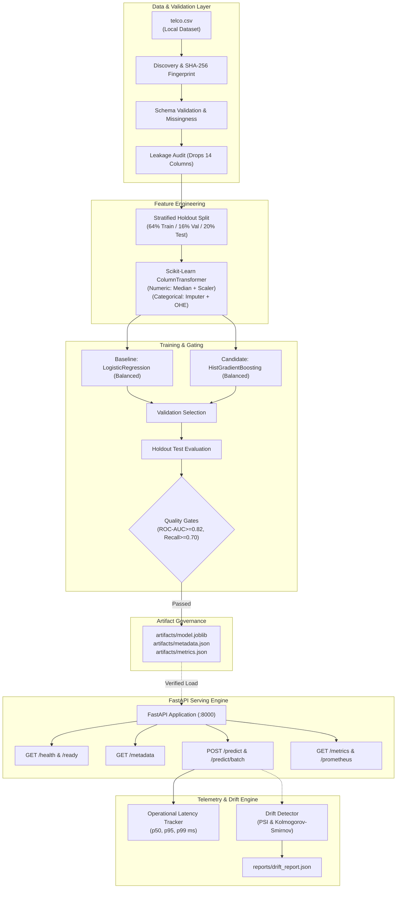

# MLOps Factory — Automated ML Training, Validation, Deployment and Monitoring Platform

[](https://github.com/Pal-Priyanka/MLOps-Factory-Automated-ML-Training-Testing-Deployment-Platform/actions)
[](https://www.python.org/downloads/)
[](https://fastapi.tiangolo.com/)
[](https://scikit-learn.org/)
[](https://opensource.org/licenses/MIT)
[](https://github.com/astral-sh/ruff)

An industry-inspired, production-ready MLOps platform for automated machine learning lifecycle management. The platform demonstrates data ingestion, cryptographic provenance fingerprinting, retrospective leakage auditing, reproducible preprocessing pipelines, model-quality acceptance gates, versioned artifact governance, low-latency REST API inference, and statistical data drift monitoring.

---

## Table of Contents
1. [Project Value Proposition](#1-project-value-proposition)
2. [Problem Statement & Business Relevance](#2-problem-statement--business-relevance)
3. [Dataset Source & Attribution](#3-dataset-source--attribution)
4. [System Architecture](#4-system-architecture)
5. [Technology Stack](#5-technology-stack)
6. [Repository Structure](#6-repository-structure)
7. [Prerequisites](#7-prerequisites)
8. [Setup & Installation](#8-setup--installation)
9. [Exact Training Command](#9-exact-training-command)
10. [Exact Testing Command](#10-exact-testing-command)
11. [Inference API Startup Instructions](#11-inference-api-startup-instructions)
12. [Example Prediction Requests & Responses](#12-example-prediction-requests--responses)
13. [Docker Build & Run Commands](#13-docker-build--run-commands)
14. [CI/CD Pipeline Automation](#14-cicd-pipeline-automation)
15. [Operational Monitoring & Drift Detection](#15-operational-monitoring--drift-detection)
16. [Empirical Model Metrics & Interpretation](#16-empirical-model-metrics--interpretation)
17. [Security & Privacy Considerations](#17-security--privacy-considerations)
18. [Known Limitations](#18-known-limitations)
19. [Troubleshooting Guide](#19-troubleshooting-guide)
20. [Future Engineering Improvements](#20-future-engineering-improvements)

---

## 1. Project Value Proposition
Many machine learning projects stop at exploratory Jupyter notebooks that suffer from silent data leakage, fragile preprocessing, manual deployment, and zero operational observability. **MLOps Factory** treats machine learning as a resilient software engineering discipline:
- **Reproducible Pipelines**: End-to-end scikit-learn pipelines guarantee that all transformations fitted on training data are identical during real-time serving.
- **Leakage Auditing**: Automatically identifies and discards 14 post-event and identifier columns before feature extraction.
- **Automated Quality Gates**: Enforces strict performance and latency thresholds; candidate models are blocked from production release if criteria fail.
- **Cryptographic Provenance**: Model artifacts are coupled with SHA-256 integrity checksums to prevent loading corrupted or tampered binaries.
- **Operational Telemetry & Drift**: Real-time request latency percentiles (`p50`, `p95`, `p99`), Prometheus scraping, and dual-method input drift detection (PSI + Kolmogorov-Smirnov).

---

## 2. Problem Statement & Business Relevance
In the telecommunications sector, customer acquisition cost (CAC) significantly exceeds the cost of subscriber retention. When a customer churns, the provider loses predictable monthly recurring revenue (MRR) and customer lifetime value (CLTV).

### The Business Asymmetry:
- **False Negatives (Missed Churners)**: Costly. High-value subscribers leave the platform unaddressed.
- **False Positives (False Alarms)**: Low cost. Loyal subscribers receive a proactive discount offer or plan upgrade (~$15-$25 retention promotion).
- **Platform Objective**: Maximize **Recall** (target >= 70%) while preserving viable **Precision** (>= 50%) to identify churn risks proactively.

---

## 3. Dataset Source & Attribution
- **Dataset**: IBM Telco Customer Churn (Enriched 50-column version).
- **Attribution**: Originally released by IBM Developer and curated across public data science repositories on Kaggle.
- **Dimensions**: 7,043 rows × 50 columns (~1.93 MB).
- **Target Variable**: `Churn Label` (`Yes`: 1,869 / 26.54%, `No`: 5,174 / 73.46%).
- **Raw File Checksum (SHA-256)**: `f056d152686daf0706cebe7364ca8101a91cfeb08a0d0a525f0a2d216fe02901`.
- **License Compliance**: The raw dataset is excluded from version control via `.gitignore` and `.dockerignore`. Consult [docs/dataset_guide.md](docs/dataset_guide.md) for placement instructions.

---

## 4. System Architecture



For full architectural specifications, refer to [docs/architecture.md](docs/architecture.md).

---

## 5. Technology Stack
- **Language**: Python 3.12
- **Machine Learning**: Scikit-Learn 1.9.1, SciPy 1.18.1, NumPy 2.4.6, Pandas 3.0.3
- **Artifact Serialization**: Joblib 1.6.0 with SHA-256 validation
- **Inference Web API**: FastAPI 0.143.1, Uvicorn 0.49.0, Starlette 1.2.1
- **Data Validation & Schemas**: Pydantic 2.14.1
- **Testing & Quality Assurance**: Pytest 9.1.1, HTTPX 0.28.1, Ruff 0.8.0
- **Containerization**: Docker (multi-stage non-root runtime), Docker Compose
- **Continuous Integration**: GitHub Actions

---

## 6. Repository Structure
```
Project-1-MLOps-Factory/
├── .github/
│   └── workflows/
│       └── ci.yml                 # Automated CI workflow (lint, test, build)
├── artifacts/
│   ├── .gitkeep                   # Directory placeholder (model binaries gitignored)
│   ├── model.joblib               # Serialized scikit-learn pipeline (generated)
│   ├── metadata.json              # Provenance manifest & SHA-256 checksum
│   ├── metrics.json               # Baseline vs Candidate test metrics
│   └── data_summary.json          # Dataset validation summary
├── configs/
│   └── config.py                  # Typed dataclass pipeline configurations
├── docs/
│   ├── architecture.md            # Deep-dive architecture & Mermaid diagrams
│   ├── model_card.md              # Mitchell et al. Model Card documentation
│   ├── runbook.md                 # Operational procedures & incident playbooks
│   ├── troubleshooting.md         # Diagnostic solutions for runtime errors
│   ├── demo_script.md             # Viva / Professor presentation script
│   └── dataset_guide.md           # Dataset source, schema, and placement guide
├── reports/
│   ├── model_evaluation_report.md # Benchmarking & confusion matrix markdown report
│   ├── data_quality_report.md     # Data quality & leakage audit report
│   └── drift_report.json          # Output of distribution drift simulation
├── scripts/
│   ├── run_pipeline.py            # CLI: Run training, gating, and report generation
│   ├── run_api.py                 # CLI: Start the FastAPI uvicorn inference server
│   └── run_drift_simulation.py    # CLI: Simulate production traffic and drift
├── src/
│   └── mlops_factory/
│       ├── __init__.py
│       ├── config.py              # Central pipeline, gate, and drift configs
│       ├── data/
│       │   ├── __init__.py
│       │   ├── discovery.py       # Recursive discovery & SHA-256 fingerprinting
│       │   └── validator.py       # Schema validation & leakage audit
│       ├── features/
│       │   ├── __init__.py
│       │   └── preprocessor.py    # Scikit-learn ColumnTransformer preprocessor
│       ├── training/
│       │   ├── __init__.py
│       │   └── train.py           # Training orchestrator & safe model loader
│       ├── evaluation/
│       │   ├── __init__.py
│       │   ├── evaluator.py       # Classification metrics, confusion matrix, PR-AUC
│       │   └── gates.py           # Model quality acceptance gate verifier
│       ├── serving/
│       │   ├── __init__.py
│       │   ├── schemas.py         # Pydantic v2 schemas for requests & responses
│       │   └── app.py             # FastAPI REST endpoints & lifecycle hooks
│       └── monitoring/
│           ├── __init__.py
│           ├── tracker.py         # Telemetry tracker & Prometheus exposition
│           └── drift.py           # Statistical drift engine (PSI & KS-test)
├── tests/
│   ├── conftest.py                # Pytest fixtures & synthetic data generators
│   ├── test_data_discovery.py     # Discovery & SHA-256 tests
│   ├── test_data_validation.py    # Schema & leakage audit tests
│   ├── test_preprocessor.py       # Preprocessor & unseen category tests
│   ├── test_training_and_artifacts.py # Training smoke test & tamper detection
│   ├── test_api.py                # FastAPI endpoint integration tests
│   └── test_monitoring_and_drift.py # PSI & KS drift detection tests
├── .dockerignore                  # Docker build exclusion rules
├── .env.example                   # Environment variables template
├── .gitignore                     # Git tracking exclusions
├── Dockerfile                     # Multi-stage, non-root lightweight Dockerfile
├── docker-compose.yml             # Local Docker Compose service configuration
├── LICENSE                        # MIT License
├── README.md                      # Comprehensive project documentation
├── requirements.txt               # Pinned production dependencies
└── requirements-dev.txt           # Testing and development dependencies
```

---

## 7. Prerequisites
- **Python**: 3.12.x or higher
- **Git**: For version control
- **Docker Desktop** *(Optional)*: Required for containerized execution

---

## 8. Setup & Installation

1. **Clone the repository**:
   ```bash
   git clone https://github.com/Pal-Priyanka/MLOps-Factory-Automated-ML-Training-Testing-Deployment-Platform.git
   cd MLOps-Factory-Automated-ML-Training-Testing-Deployment-Platform
   ```

2. **Create and activate a virtual environment**:
   ```bash
   # Windows (PowerShell)
   python -m venv .venv
   .\.venv\Scripts\Activate.ps1

   # Linux / macOS
   python3 -m venv .venv
   source .venv/bin/activate
   ```

3. **Install dependencies**:
   ```bash
   pip install --upgrade pip
   pip install -r requirements-dev.txt
   ```

4. **Verify dataset placement**:
   Confirm that `telco.csv` is present in the workspace root directory.

---

## 9. Exact Training Command

To execute the complete data validation, stratified splitting, model fitting, quality gating, artifact packaging, and markdown report generation:

```bash
python scripts/run_pipeline.py
```

### Generated Artifacts:
- `artifacts/model.joblib`: Fitted Scikit-Learn Pipeline
- `artifacts/metadata.json`: Provenance manifest, environment versions, and SHA-256 checksum
- `artifacts/metrics.json`: Empirical test metrics for baseline and candidate
- `reports/model_evaluation_report.md`: Markdown evaluation report with confusion matrix
- `reports/data_quality_report.md`: Leakage audit and feature distributions

---

## 10. Exact Testing Command

Execute the complete automated test suite across all 32 unit and integration tests:

```bash
pytest -v --durations=10
```

*Expected output*: `32 passed in ~2.00s`.

---

## 11. Inference API Startup Instructions

To launch the FastAPI inference server with live reload:

```bash
python scripts/run_api.py --host 0.0.0.0 --port 8000
```

### Available Endpoints:
- **Interactive Swagger Documentation**: `http://localhost:8000/docs`
- **ReDoc Documentation**: `http://localhost:8000/redoc`
- **Liveness Probe**: `http://localhost:8000/health`
- **Readiness Probe**: `http://localhost:8000/ready`
- **Governance Metadata**: `http://localhost:8000/metadata`
- **Real-Time Prediction**: `POST http://localhost:8000/predict`
- **Batch Prediction**: `POST http://localhost:8000/predict/batch`
- **JSON Telemetry**: `http://localhost:8000/metrics`
- **Prometheus Scraper**: `http://localhost:8000/metrics/prometheus`

---

## 12. Example Prediction Requests & Responses

### 12.1 Single Customer Prediction (`POST /predict`)

#### Request:
```bash
curl -X POST "http://localhost:8000/predict" \
     -H "Content-Type: application/json" \
     -d '{
       "customer": {
         "Gender": "Female",
         "Age": 55,
         "Under 30": "No",
         "Senior Citizen": "No",
         "Married": "Yes",
         "Dependents": "No",
         "Number of Dependents": 0,
         "Population": 32000,
         "Referred a Friend": "No",
         "Number of Referrals": 0,
         "Tenure in Months": 3,
         "Offer": "Offer E",
         "Phone Service": "Yes",
         "Avg Monthly Long Distance Charges": 24.50,
         "Multiple Lines": "No",
         "Internet Service": "Yes",
         "Internet Type": "Fiber Optic",
         "Avg Monthly GB Download": 18,
         "Online Security": "No",
         "Online Backup": "No",
         "Device Protection Plan": "No",
         "Premium Tech Support": "No",
         "Streaming TV": "Yes",
         "Streaming Movies": "Yes",
         "Streaming Music": "No",
         "Unlimited Data": "Yes",
         "Contract": "Month-to-Month",
         "Paperless Billing": "Yes",
         "Payment Method": "Bank Withdrawal",
         "Monthly Charge": 85.50,
         "Total Charges": 256.50,
         "Total Refunds": 0.00,
         "Total Extra Data Charges": 0,
         "Total Long Distance Charges": 73.50,
         "Total Revenue": 330.00,
         "CLTV": 3800
       }
     }'
```

#### Response (`HTTP 200 OK`):
```json
{
  "churn_prediction": true,
  "churn_probability": 0.9292,
  "risk_tier": "High",
  "recommended_action": "Immediate outreach: assign dedicated retention specialist with competitive tariff match.",
  "model_name": "Baseline_LogisticRegression",
  "model_version": "2026d456",
  "latency_ms": 40.08
}
```

---

### 12.2 Malformed Request Error Handling (`POST /predict`)

#### Request (Invalid Negative Age):
```bash
curl -X POST "http://localhost:8000/predict" \
     -H "Content-Type: application/json" \
     -d '{"customer": {"Age": -25}}'
```

#### Response (`HTTP 422 Unprocessable Entity`):
```json
{
  "error": "Validation Error",
  "message": "Supplied input payload does not match expected schema contract.",
  "details": [
    {
      "type": "greater_than_equal",
      "loc": ["body", "customer", "Age"],
      "msg": "Input should be greater than or equal to 0",
      "input": -25,
      "ctx": {"ge": 0}
    }
  ]
}
```

---

## 13. Docker Build & Run Commands

### 13.1 Build & Run with Plain Docker:
```bash
# Build multi-stage image
docker build -t mlops-factory-api:latest .

# Run container as non-root user on port 8000
docker run -d --name mlops-api -p 8000:8000 mlops-factory-api:latest

# Check container health status
docker inspect --format='{{json .State.Health}}' mlops-api

# View container logs
docker logs -f mlops-api
```

### 13.2 Run with Docker Compose:
```bash
docker compose up --build -d
docker compose ps
docker compose down
```

---

## 14. CI/CD Pipeline Automation
The GitHub Actions workflow (`.github/workflows/ci.yml`) runs automatically on pushes and pull requests to `main`:
1. **Checkout**: Clones the repository code.
2. **Environment**: Sets up Python 3.12 with pip caching.
3. **Dependencies**: Installs `requirements-dev.txt`.
4. **Linting**: Runs `ruff check` on `src/`, `tests/`, and `scripts/`.
5. **Testing**: Runs `pytest -v --durations=10`.
6. **Container Verification**: Executes `docker build -t mlops-factory-api:ci .` to confirm image integrity.

---

## 15. Operational Monitoring & Drift Detection

### 15.1 Operational Metrics Tracker
- Endpoint: `GET /metrics` and `GET /metrics/prometheus`
- Exposes:
  - Uptime in seconds.
  - Total requests, successful predictions, and failed requests.
  - Prediction class distributions (`0_retained` vs `1_churn`).
  - Request latency percentiles (`mean`, `min`, `max`, `p50`, `p95`, `p99` ms).

### 15.2 Statistical Drift Detection
- Engine: `mlops_factory.monitoring.drift`
- Computes:
  - **Population Stability Index (PSI)** on numerical and categorical features.
  - **Two-Sample Kolmogorov-Smirnov (KS) Test** on continuous features.
- CLI Simulation:
  ```bash
  python scripts/run_drift_simulation.py
  ```
- **Operational Principle**: The monitoring system explicitly flags statistical distribution shifts without falsely claiming real-time predictive degradation, as true subscriber churn labels only manifest after billing cycle conclusion.

---

## 16. Empirical Model Metrics & Interpretation

The following metrics were computed on the untouched 20% holdout test set (1,409 customers):

| Metric | Baseline (`LogisticRegression`) | Candidate (`HistGradientBoosting`) | Delta |
| :--- | :---: | :---: | :---: |
| **ROC-AUC** | **0.9087** | 0.9043 | -0.0044 |
| **PR-AUC** | **0.7860** | 0.7716 | -0.0144 |
| **Accuracy** | 0.7984 | **0.8311** | +0.0327 |
| **Recall (Churners)** | **0.8770** | 0.7861 | -0.0909 |
| **Precision (Churners)** | 0.5795 | **0.6504** | +0.0709 |
| **F1-Score** | 0.6979 | **0.7119** | +0.0140 |
| **Training Duration** | **0.09s** | 1.59s | +1.50s |

### Quality Gate Results:
- `ROC-AUC` (>= 0.82): **PASSED** (0.9087)
- `Recall` (>= 0.70): **PASSED** (0.8770)
- `Precision` (>= 0.50): **PASSED** (0.5795)
- `F1-Score` (>= 0.60): **PASSED** (0.6979)
- `Accuracy` (>= 0.75): **PASSED** (0.7984)
- `Training Duration` (<= 120s): **PASSED** (0.09s)
- **Status**: **PASSED (Production-Ready)**

---

## 17. Security & Privacy Considerations
1. **Unprivileged Container Execution**: The Dockerfile defines an unprivileged user `appuser` (UID 10001) without sudo or root privileges.
2. **Zero Information Leakage in Errors**: Custom exception handlers sanitize stack traces and internal paths, returning consistent error bodies.
3. **No Personal Data Logging**: The request telemetry middleware logs request IDs, methods, paths, and response latencies, but omits customer financial and identity details.
4. **Cryptographic Model Verification**: Model artifacts are loaded only after validating their SHA-256 checksum against `metadata.json`, safeguarding against pickle tampering.

---

## 18. Known Limitations
1. **Geographic Scope**: Dataset reflects California telecommunications subscribers during Q3. Model deployment in differing geographic markets requires transfer learning and domain recalibration.
2. **Delayed Feedback Loop**: Ground-truth churn labels require 30 to 60 days to resolve in production. Accuracy drift must be estimated via input distribution drift (PSI/KS) until ground truth becomes available.
3. **Single-Node In-Memory Telemetry**: The default telemetry tracker operates in-memory. Multi-instance distributed deployments require an external Prometheus collector or Redis cache.

---

## 19. Troubleshooting Guide
For detailed failure diagnoses and recovery procedures, refer to [docs/troubleshooting.md](docs/troubleshooting.md).

Quick references:
- **Port 8000 in use**: Run `python scripts/run_api.py --port 8080`.
- **Docker missing**: Run locally via standard Python virtual environment.
- **503 on `/predict`**: Ensure `python scripts/run_pipeline.py` was executed to generate `artifacts/model.joblib`.

---

## 20. Future Engineering Improvements
- [ ] Integration of ONNX runtime for sub-10ms model execution.
- [ ] Automated scheduled retraining workflows triggered by GitHub Actions or cron.
- [ ] Continuous integration of Evidently AI / Great Expectations for automated data suite testing.
- [ ] Helm chart definitions for Kubernetes multi-pod horizontal pod autoscaling (HPA).
