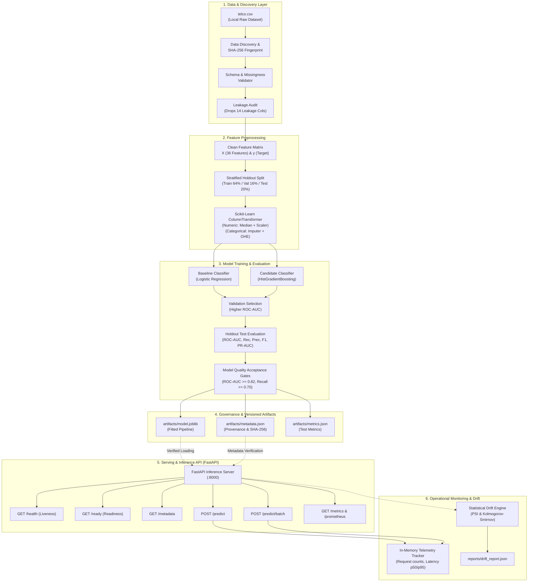

# System Architecture & Technical Design

## 1. Executive Overview

**MLOps Factory** is an automated machine learning training, validation, deployment, and operational monitoring platform designed for tabular customer retention workflows. The platform enforces strict separation of concerns, guarantees reproducible data transformations, eliminates data leakage, and provides production-grade API inference with operational telemetry.

---

## 2. Architecture Diagram

---

## 3. Component Breakdown

### 3.1 Data Ingestion & Discovery (`mlops_factory.data`)
- **Discovery (`discovery.py`)**: Recursively discovers dataset CSV files while ignoring `.git`, virtual environments, and generated directories. Calculates deterministic SHA-256 fingerprints to verify data provenance.
- **Validation (`validator.py`)**: Enforces required schema columns, checks binary target integrity, and executes a strict audit to detect and flag 14 post-event and identifier leakage columns.

### 3.2 Feature Preprocessing (`mlops_factory.features`)
- **Preprocessor (`preprocessor.py`)**: Constructs an encapsulated scikit-learn `ColumnTransformer`. 
  - **Numeric pipeline**: `SimpleImputer(strategy='median')` followed by `StandardScaler()`.
  - **Categorical pipeline**: `SimpleImputer(strategy='constant', fill_value='None')` followed by `OneHotEncoder(handle_unknown='ignore', sparse_output=False)`.
  - Guarantees zero leakage by fitting strictly on training splits.

### 3.3 Training & Quality Gates (`mlops_factory.training`, `mlops_factory.evaluation`)
- **Training Orchestration (`train.py`)**: Orchestrates stratified splits (Train/Val/Test), trains both a balanced linear baseline (`LogisticRegression`) and a non-linear tree-based candidate (`HistGradientBoostingClassifier`), performs validation selection, and tests the winner on holdout test data.
- **Model Quality Gates (`gates.py`)**: Automated verification against predefined thresholds:
  - Minimum ROC-AUC: `0.82`
  - Minimum Recall (churners): `0.70`
  - Minimum Precision: `0.50`
  - Minimum F1-Score: `0.60`
  - Minimum Accuracy: `0.75`
  - Maximum Training Duration: `120.0s`

### 3.4 Serving Engine (`mlops_factory.serving`)
- **REST API (`app.py`)**: Built on FastAPI, offering sub-50ms inference latency.
- **Typed Contracts (`schemas.py`)**: Pydantic v2 schemas providing automatic validation, casting, and error responses.
- **Lifespan Management**: Validates model artifact checksum on startup; if artifact is missing or altered, gracefully degrades readiness (`503 Service Unavailable`) while keeping liveness (`200 OK`) active.

### 3.5 Monitoring & Telemetry (`mlops_factory.monitoring`)
- **Telemetry Tracker (`tracker.py`)**: Thread-safe tracker computing request counts, error counts, latency percentiles (`p50`, `p95`, `p99`), and prediction distribution. Supports Prometheus scraping.
- **Drift Engine (`drift.py`)**: Implements Population Stability Index (PSI) and two-sample Kolmogorov-Smirnov (KS) tests to detect feature distribution shifts between production inference traffic and training reference distributions.

---

## 4. Security & Isolation Boundaries

1. **Non-Root Execution**: Container runs under dedicated unprivileged UID `10001` (`appuser`).
2. **Path Sanitization**: Error handlers catch internal exceptions and return standardized JSON without revealing stack traces, file paths, or system credentials.
3. **Model Integrity**: Serialized model files are hashed with SHA-256 during training; the serving layer verifies this hash on startup before unpickling.
4. **Data Isolation**: Raw datasets and local `.env` configuration files are strictly excluded from git tracking via `.gitignore` and `.dockerignore`.
